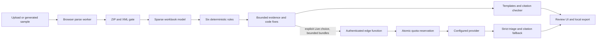

# Architecture

**Status: source constructed; runtime unverified; provisioning pending.** No install, build, test, generator/evaluator run, auth/database operation or live provider call has validated this design. [BOLT-HANDOFF](../BOLT-HANDOFF.md) is the infrastructure inventory; [deferred validation](DEFERRED-VALIDATION.md) records activation work.

## Local audit path

`src/core/audit.ts` runs the pure gate → model → rules → evidence → template/checker pipeline. The worker receives transferred workbook bytes and returns plain JSON. Workbook bytes are not uploaded. The reader stores sparse cells, expanded shared formulas, caches/types/styles, array membership, merges, defined names, external-link metadata and coverage. It never recalculates formulas or follows links.

The gate bounds compressed bytes (5 MiB), declared/actual inflation (50 MiB), package parts (2,000), sheets (20) and formulas (50,000), and refuses unsupported containers/macros and malformed or unsafe package structures. Reader/tokenizer coverage explicitly records unsupported constructs; these limits and parser semantics remain unverified against real writers.

The registry fixes tiers: cached error and broken reference are Confirmed; formula drift, numeric plug and short SUM are Likely; mixed units is Review. Findings retain individual identities even when propagated errors are grouped for display. Formula fixes come from code/token rebasing, never model output.

## Evidence and optional models

`core/evidence` creates canonical hashed bundles bounded to 2,048 UTF-8 bytes and four neighbours per side. Required evidence is never truncated. If the minimum does not fit, template-only evidence is retained and that finding is model-ineligible. Code templates cite only their evidence window; a short SUM's distant start is confined to its suggested fix.

`core/triage` selects at most 200 eligible findings, validates response identity/hash/schema and retains all raw findings. Models can change disposition and checked explanation only. Confirmed findings are not sent or changed by model triage; Jev selection is Review-only. Missing, duplicate, extra or mismatched responses fall back. The citation checker verifies address membership and exact numeric grounding; failed model prose is replaced by the checked code template, or marked unavailable if that also fails.

Template mode has no provider request. Mock uses an exact cache key and throws on a miss. Generated budget samples alone may receive synthetic in-memory demo responses, labelled synthetic; this is separate from recorded-live evaluation evidence. Live browser calls use `core/providers/edgeClient.ts`, which sends bounded bundles and a user JWT to the edge function. Provider keys remain server-side. Paid Jev is disabled pending a documented output/spend bound; the dated price table is empty, so browser Live also remains gated.

The edge function deploys self-contained `_shared` copies of prompt, strict triage schema, limits, canonical JSON and SHA-256. A written byte-equality test compares their canonical sources. It authenticates with `getUser`, validates actual streamed bytes and bundle hashes, checks configuration, reserves once, then performs at most two single-attempt provider calls. It never logs workbook evidence or provider bodies.

## Identity, rulings and privacy

| Identity | Meaning |
|---|---|
| Workbook SHA-256 | Exact file bytes; any serialization/content change makes a different version. |
| Finding id | Hash of rule, sheet and A1 cell; coordinates are not stable across row insertion. |
| Formula hash | Versioned hash of expanded formula text or typed constant; used for stale carry-over. |
| Ruling event UUID | Append-only, first-write-wins idempotency key. |
| Lineage UUID | Explicitly linked versions owned by the same user. |

Version registration is lazy: first ruling or explicit version-link choice, not upload. A registered version's lineage is immutable. Exact-file rulings replay automatically. Cross-file carry requires a persisted explicit link; the latest timestamp/event-id candidate is shown, with `stale` when its formula hash differs. Stale decisions are history and are not applied. Current human confirm/dismiss/by-design decisions override model set-aside grouping, while exports retain everything.

The `RulingsStore` interface is shared by both adapters. Local storage uses IndexedDB, then localStorage, then labelled memory fallback. Cloud storage uses owner-filtered Supabase metadata queries plus device-only note KV keys containing both user and event id. Cloud rows contain file/version identity, rule/cell/formula hash, decision, timestamps, note presence and insertion order; no note text, values, formulas or evidence. Display names remain user-supplied metadata. Insertion-order identity is separate from replay event ordering.

Migration 1 creates `workbook_versions` and `rulings`; RLS permits only own SELECT/INSERT and checks same-owner linked lineage/registered ruling versions. No client UPDATE/DELETE is granted. Migration 2 creates the four private quota/config/reservation tables and a narrowly granted security-definer RPC. It reserves twice the submitted bundle count against atomic user/global UTC-day caps, including both first-insert and conflict-update paths.

Cloud metadata and device notes are not one transaction. If a note write fails after cloud insertion, the adapter reports partial persistence; another device has only the note marker. Nothing here promises encrypted browser storage or note synchronization.

## Async UI boundaries and reports

`app/App.tsx` tags state by active owner, workbook hash and request/triage generation. Owner changes clear visible work; worker completion, storage opening, readiness and triage responses are checked before adoption. `useAuth` lets newer auth events supersede an older session-restore response, keeps callbacks synchronous and unsubscribes on cleanup. These are source guards, not proven runtime isolation.

`core/report` produces a detached `ReportV1` snapshot: workbook/link metadata, coverage/skipped rules, external links, not-triaged count, mode, findings and set-aside findings. Dismissed findings, stale/carry metadata and locally available note text remain in JSON/Markdown exports. These exports are local artifacts and can contain sensitive workbook evidence and notes.

## Generator and evaluation seam

`generator/build.ts` owns split routing and explicit clean/injected pair metadata. Five templates, explicit arithmetic caches, six defect injectors and named intentional traps feed a fixed-order/timestamp XLSX writer. The planned 40 dev + 40 final-split allocation and count minima are source assertions, not measured corpus results. Browser samples use `generator/samples.ts`; no binary sample is required in the repository.

`scripts/generate-workbooks.ts --freeze` writes measured file hashes, manifest hash, seed/version/date only when activated into a fresh output. Inspection must use a different scratch output because writes are exclusive.

The evaluator reads actual disk manifest/index/freeze artifacts and verifies hashes; it does not regenerate its oracle. Matching normalizes/deduplicates workbook/rule/cell identity, gives primary TP precedence over allowed-secondary neutral hits, counts other hits as FP and unmatched eligible defects as FN. It reports raw and surfaced per-rule/pooled micro metrics, Wilson intervals, defined-rule macro points, citations, set-aside cases, pair deltas, explanation coverage, ledger latency/cost and named failures. Macro intervals are N/A because a mean of rule proportions is not one binomial observation.

The final-split run lock pins corpus/manifest, committed clean source, prompt, thresholds and model/cache/provider-mode context. A separate ledger reserves live-call budget before transport. Durable receipts resume missing work without repeating completed calls; a completed experiment cannot be rerun. An existing process lease fails closed and requires explicit abandoned-lease recovery. These filesystem protections and static split-isolation tests are local workflow controls, not a security boundary against arbitrary filesystem edits. Results remain ungenerated.
